# TD5 Dash

Tableau de bord et outil de diagnostic pour moteur **Land Rover TD5**, pensé pour un
autoradio Android de 1024 × 600, lisible d'un coup d'œil en conduisant.

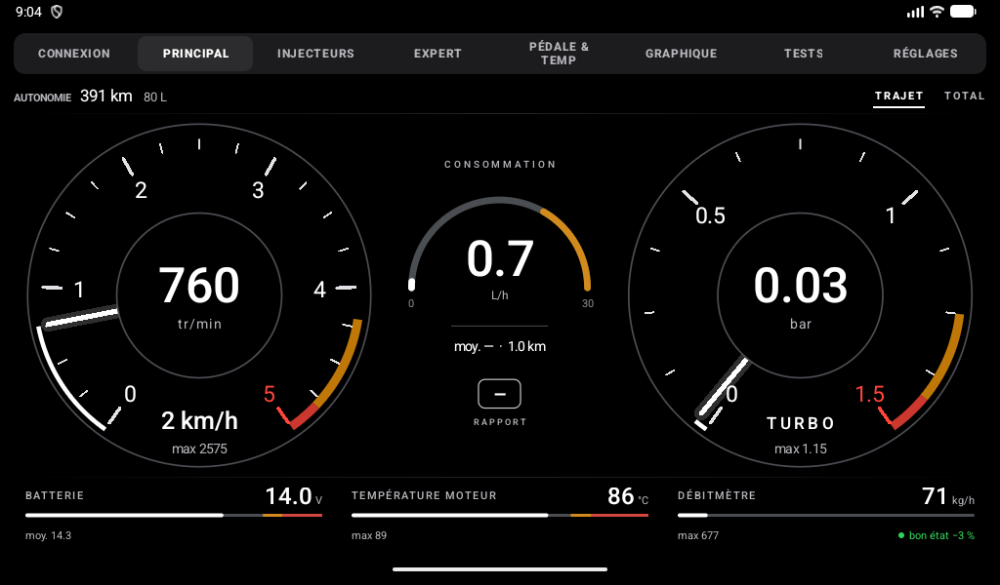

L'application se connecte toute seule au calculateur dès que le câble est détecté, et
s'ouvre directement sur les jauges.

---

## Le principe : le silence veut dire que tout va bien

Le style reprend celui des écrans conducteur récents : blanc pur sur fond noir, chiffres
en graisse moyenne, traits assez épais et zones orange et rouge franches sans être
criardes, pour rester lisible en plein soleil comme de nuit. Les valeurs restent
**blanches** tant qu'elles sont dans leur plage normale ; la couleur n'apparaît **que**
lorsqu'une valeur en sort. Un écran blanc veut dire que tout est correct.

| État | Couleur | Exemple |
|---|---|---|
| Normal | blanc | liquide à 86 °C |
| Encore froid | bleu | liquide sous 70 °C |
| Attention | orange | liquide au-dessus de 96 °C |
| Alerte | rouge | liquide au-dessus de 105 °C |

Les mêmes couleurs gardent le même sens partout : vert pour le bon, orange à surveiller,
rouge pour agir, bleu pour une donnée neutre dans les graphiques.

---

## Les écrans

### Principal

Deux grands cadrans à aiguille, **régime** (avec la vitesse dessous) et **turbo**, leurs
zones orange et rouge dans le cercle. Au centre, la **consommation instantanée** sur un
demi-cadran fin (L/100 km en roulant, L/h à l'arrêt) avec un repère sur la moyenne, la
moyenne et les kilomètres, puis le **rapport engagé**. En bas, **batterie**,
**température moteur** et **débitmètre** en barres fines.

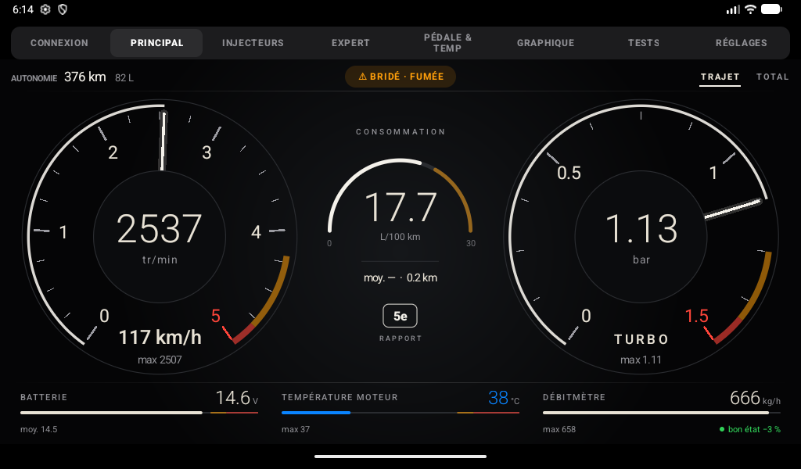

- **Témoin « BRIDÉ »** : en haut au centre, il s'allume quand le calculateur retient le
  gasoil, par la limite de fumée (le turbo n'a pas encore soufflé) ou par la limite de
  couple. Le reste du temps, la place sert au bandeau de montée en température.
- **Rapport engagé** : le calculateur n'a pas de capteur de boîte ; l'application
  l'apprend toute seule à partir du régime et de la vitesse (boîte R380, gamme courte
  affichée 1L, 2L…). Il apparaît après quelques minutes de route.
- **Trajet / Total** : les petites lignes sous chaque valeur (max, moyennes, kilomètres)
  montrent le trajet en cours ou, en violet, le total conservé jusqu'à sa remise à zéro
  (appui long sur « Total »).
- **Autonomie** : en haut à gauche, les kilomètres et litres restants. On déclare chaque
  plein, complet ou partiel ; les litres affichés par la pompe servent à **caler
  automatiquement la consommation** d'un plein complet à l'autre, et à signaler les
  trajets faits sans la tablette.

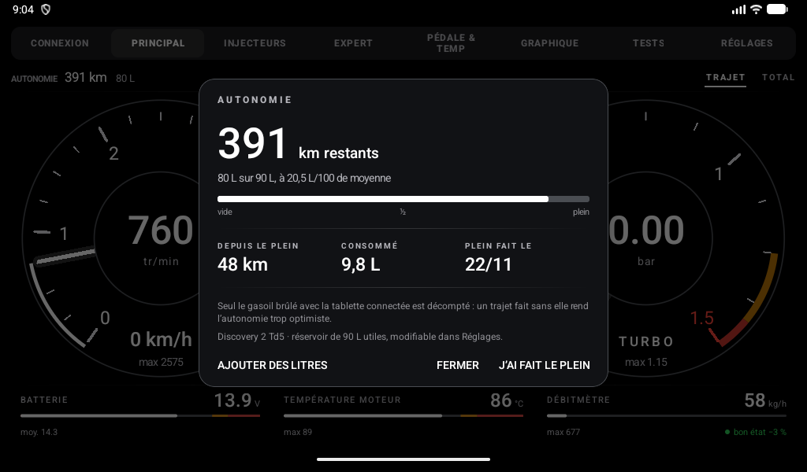

- **État du débitmètre** : sous sa barre, l'écart entre le débitmètre et l'estimation du
  calculateur par le capteur de collecteur, mesuré moteur chaud, en charge et en régime
  stable (EGR fermée). Vert, orange ou rouge, avec l'historique des derniers trajets.
  Sur un moteur **reprogrammé**, ce calcul ou la plage du débitmètre ont pu être modifiés :
  la référence **Apprise** prend les 3 premiers trajets comme référence du véhicule et ne
  juge plus que la dérive. L'écart est aussi donné par pression de turbo, pour distinguer
  un débitmètre en bout de plage d'un débitmètre usé.

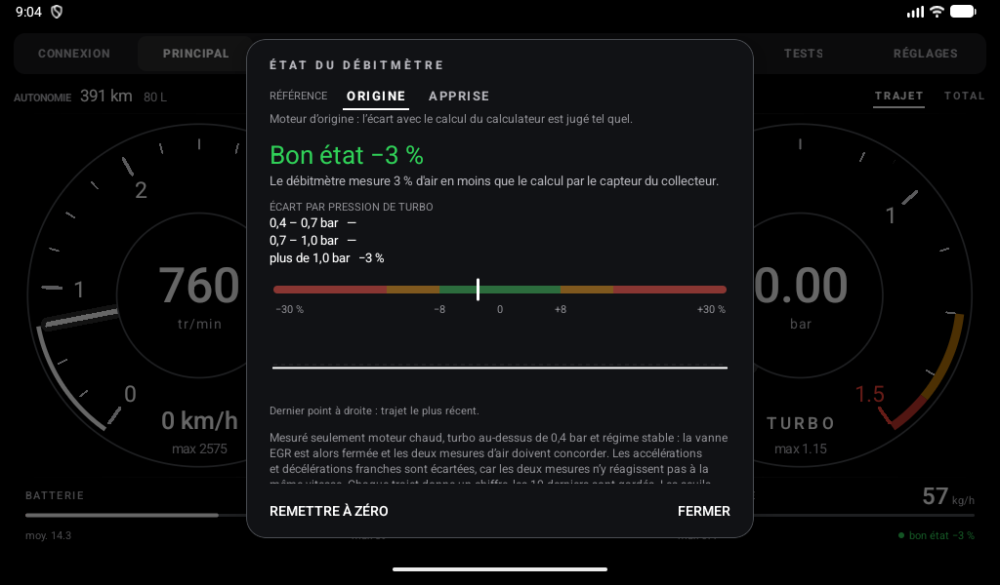

### Injecteurs


Balance des cinq injecteurs sur des réglettes graduées autour de zéro, avec une bande
verte de −4 à +4 : l'injecteur qui s'écarte saute aux yeux, et le plus écarté est
rappelé à droite. L'application connaît le régime et la température : elle annonce
**moteur froid** ou **pas au ralenti** quand les conditions de mesure ne sont pas
réunies, plutôt que de laisser lire des valeurs qui ne veulent rien dire.

### Expert

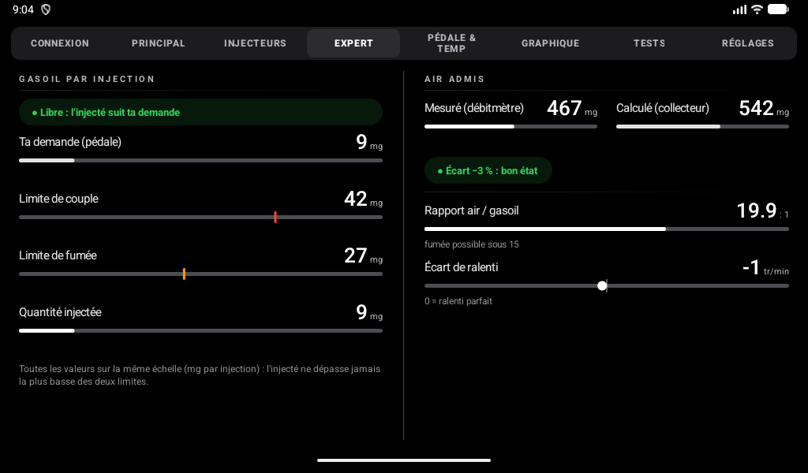

À gauche, le gasoil par injection **sur une même échelle** : ta demande à la pédale, les
limites de couple et de fumée (des repères), la quantité injectée. Un verdict dit en
clair si le moteur est libre ou bridé, et par quoi. À droite, l'air mesuré au débitmètre
et calculé au collecteur avec l'état du débitmètre, puis le rapport air / gasoil et
l'écart de ralenti.

### Pédale et températures


L'enfoncement de la pédale et ses trois voies, avec un verdict : les trois voies doivent
concorder, une voie qui dérive annonce une pédale qui va passer en mode dégradé. À
droite, les températures gasoil, admission et extérieure (normale, chaude, trop chaude)
et la pression ambiante avec l'altitude estimée.

### Graphique

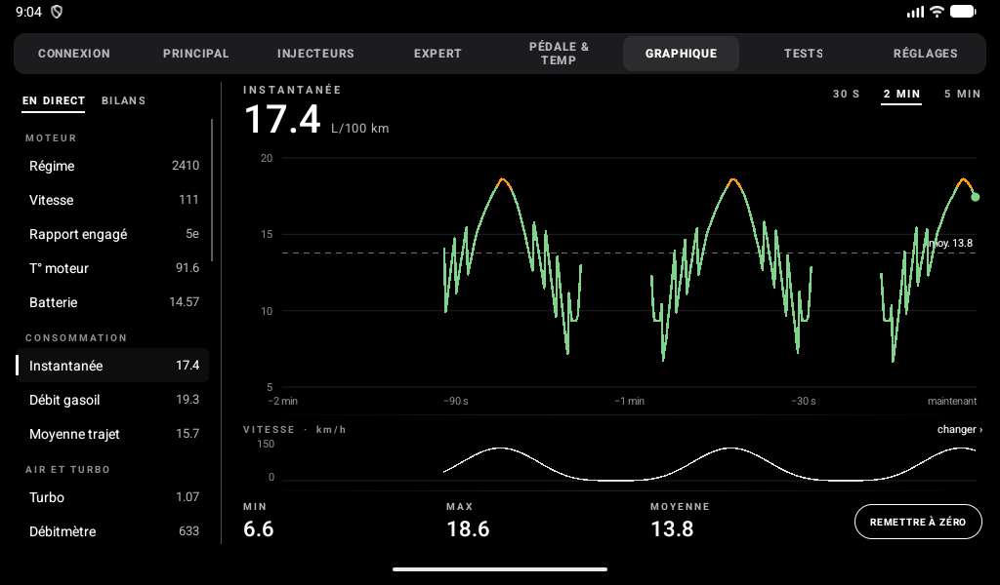

**En direct** : un signal tracé sur 30 s, 2 min ou 5 min, avec son minimum, son maximum
et sa moyenne, et un **second signal en bande dessous** pour l'expliquer (la vitesse
sous la consommation, le régime sous le turbo…, au choix). La consommation instantanée
est colorée : verte sous ta moyenne, orange au-dessus, rouge quand elle est forte.

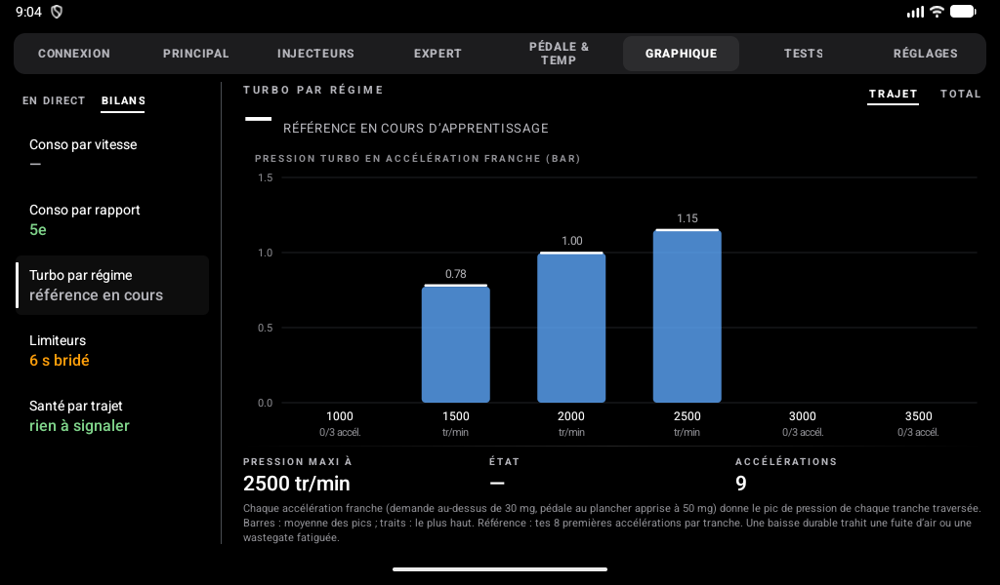

**Bilans**, pour le trajet ou le total, chacun avec sa conclusion dans la liste :

- **Conso par vitesse** : L/100 km par tranche de vitesse, la plus sobre en vert ;
- **Conso par rapport** : L/100 km selon le rapport engagé ;
- **Turbo par régime** : le pic de pression de chaque accélération franche, par tranche
  de régime (3 accélérations suffisent par tranche, la progression est affichée),
  comparé à une référence apprise sur les 8 premières. La demande « pédale au plancher »
  s'apprend toute seule, utile sur un moteur reprogrammé. Une baisse durable trahit
  une fuite d'air ou une wastegate fatiguée ;
- **Limiteurs** : le gasoil face aux limites de fumée et de couple, et le temps passé
  bridé sur le trajet ;
- **Santé par trajet** : un point par trajet pour le débitmètre, les injecteurs, le turbo
  à 2500 tr/min et la batterie au démarrage, pour voir une usure lente.

### Tests d'actionneurs

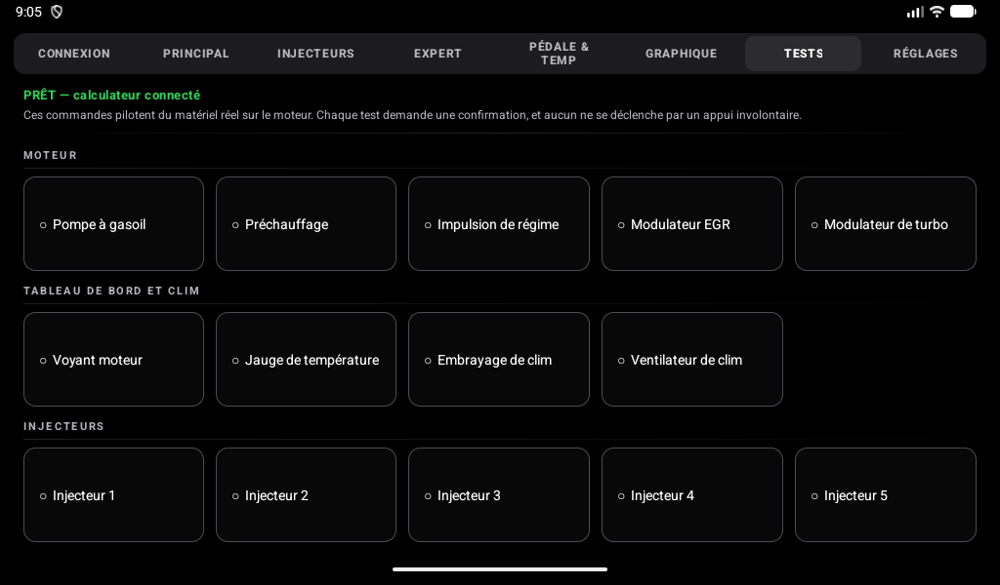

Quatorze commandes envoyées au calculateur, rangées par famille : moteur (pompe à
gasoil, préchauffage, impulsion de régime, modulateurs EGR et turbo), tableau de bord et
clim, et chaque injecteur isolément.

Les boutons sont **désactivés tant que le calculateur n'est pas connecté**, et chaque test
demande une confirmation avec un avertissement adapté.

### Connexion

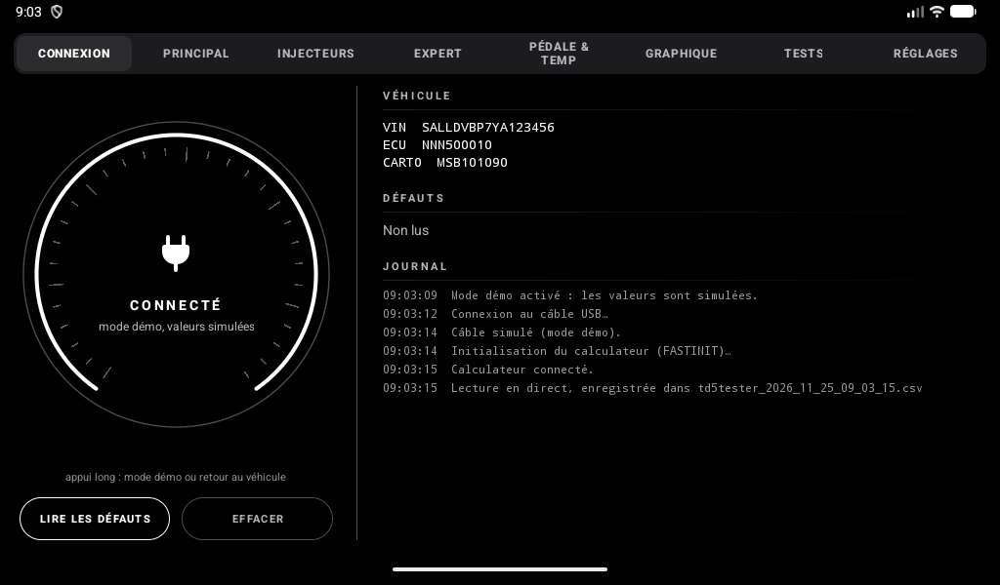

Le bouton de connexion dans un anneau d'état : **blanc** une fois connecté, **rouge**
sans signal. À droite, l'identité du véhicule lue au calculateur (VIN, type d'ECU,
variante de cartographie), les codes défaut et le journal. L'effacement des défauts
demande confirmation et prévient que c'est irréversible.

### Réglages

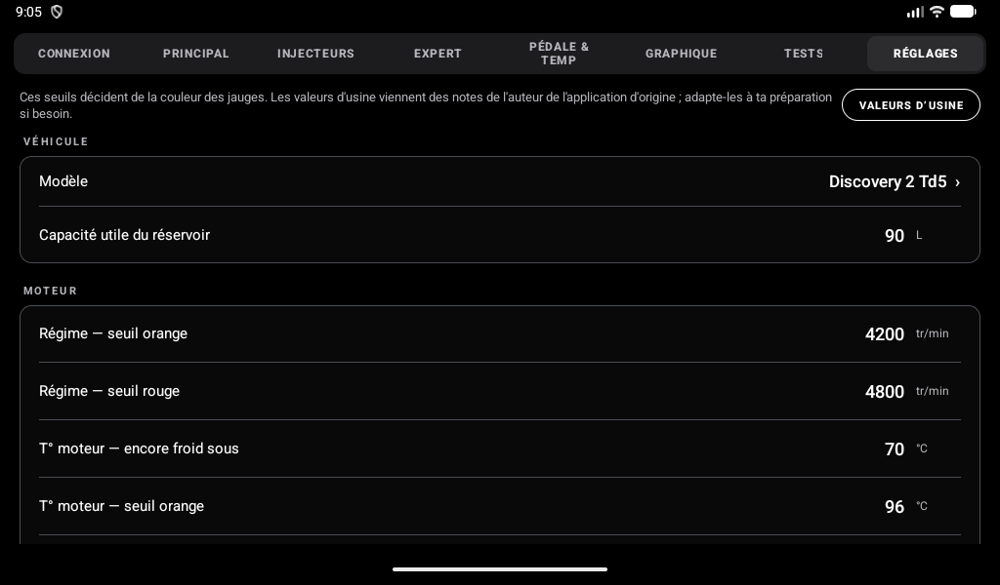

Rangés par blocs : le **modèle** (Discovery 2, Defender 90, 110 ou 130), qui fixe la
capacité utile du réservoir, puis les seuils et corrections : couleurs des jauges,
**correction de vitesse** pour des pneus non d'origine (vitesse compteur et vitesse GPS
au même moment, par exemple 120 et 130), correction de consommation. Les valeurs d'usine
des seuils viennent des notes publiées par l'auteur de l'application d'origine. Un
bouton remet tout en place.

---

## Aide à la lecture

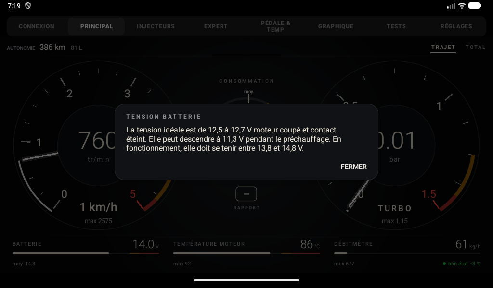

Chaque jauge porte un **ⓘ**. Un appui ouvre sa fiche : ce que la valeur signifie, les
plages attendues, et le pic de la session avec un bouton de remise à zéro.

---

## Écran partagé


L'application accepte le mode fenêtré et bascule sur une mise en page compacte sous 700
points de large, pour tenir à côté d'un GPS. Les pop-ups et l'onglet Graphique s'y
adaptent aussi.

---

## Matériel

Un câble **KKL VAG-COM à puce FTDI FT232R** (`0403:6001`), branché sur le port USB de
l'autoradio et sur la prise diagnostic du véhicule.

Au premier branchement, Android propose **« Toujours ouvrir pour cet appareil »**. Cocher
la case accorde l'autorisation une fois pour toutes et lance l'application dès que le
câble est détecté.

---

## Installation

Télécharger [l'APK](apk/td5-dash-v1.6.apk) et l'ouvrir sur l'autoradio. Les versions suivantes s'installent par-dessus, sans désinstaller.
Il faut autoriser l'installation depuis des sources inconnues.

L'application s'installe **à côté** de TD5 InfoDash, avec son propre identifiant
`com.mooo.hairyone.td5dash` : les deux peuvent cohabiter.

### Mode démo

Un **appui long sur le bouton de connexion** simule les valeurs à partir d'un cycle
moteur cohérent : la vitesse passe les rapports de la boîte, le régime suit, le turbo
arrive avec un temps de retard (le moteur est alors brièvement bridé par la fumée), le
débit et les températures suivent. Les données de la démo sont tenues à part de celles
du véhicule.
Utile pour montrer l'application ou travailler l'interface sans véhicule. Le mode est un
drapeau d'exécution, désactivé par défaut, jamais compilé dans l'application.

---

## Corrections de données

Le code d'origine comportait plusieurs erreurs d'affichage, corrigées ici :

| Problème | Ce qui se passait | Maintenant |
|---|---|---|
| Valeurs négatives | la jauge écrêtait à zéro, donc toute la moitié négative de la balance injecteur était invisible | jauge bipolaire, le négatif s'affiche |
| Turbo faux en altitude | une atmosphère fixe de 1 bar était soustraite ; à 1500 m la jauge annonçait 0,15 bar au ralenti | la pression ambiante **mesurée** est utilisée |
| Enfoncement de pédale | affiché « 5 VOLT » alors que c'est 50 % de pédale | converti et affiché en pourcentage |
| Sonde de boîte à air | absente sur les 10P, elle affichait 197 °C comme une vraie mesure | un tiret |
| Débitmètre mort | 0 ou 4,4 kg/h s'affichaient comme des mesures | un tiret |
| Données figées | une lecture ratée laissait la dernière valeur à l'écran, indiscernable d'une valeur vivante | **SIGNAL PERDU** après 2,5 s |
| Couple et fumée | les deux octets étaient lus dans l'ordre inverse | ordre corrigé, voir ci-dessous |

Sur le dernier point, les sources sont contradictoires. L'ordre retenu est celui de la
version 3 de l'application d'origine, appuyé sur les libellés du projet
[Ekaitza_Itzali](https://github.com/EA2EGA/Ekaitza_Itzali) et sur un relevé réel où la
limite de fumée est bien la plus basse des deux au ralenti chaud. **Confiance estimée à
80 %**, faute de documentation constructeur.

Les conversions et les calculs (consommation, réservoir, débitmètre, rapport engagé,
limiteurs, bilans) sont isolés dans des classes pures et couverts par **120 tests
unitaires**.

---

## Compiler depuis les sources

```bash
./gradlew assembleDebug
./gradlew testDebugUnitTest
```

JDK 17, AGP 8.7, `minSdk` 21, `targetSdk` 34.

---

## Origine et licence

Ce projet dérive de [hairyone/TD5Tester](https://github.com/hairyone/TD5Tester), sous
licence Apache 2.0, et du code source « TDB TD5 V2 » publié par l'auteur de TD5 InfoDash.

Le protocole de dialogue avec le calculateur, les requêtes ECU et la table des codes
défaut viennent de ces deux projets. Ce dépôt y ajoute la migration vers un socle Android
moderne, la refonte de l'interface, les corrections de données listées ci-dessus, les
tests unitaires et les réglages.

Licence Apache 2.0, voir [LICENSE](LICENSE) et [NOTICE](NOTICE).

---

## Ce qui n'est pas éprouvé

- Les **tests d'actionneurs** n'ont jamais été envoyés à un vrai calculateur. Les trames
  viennent du projet d'origine et sont justes sur le papier, mais à prendre comme non
  vérifiées. Commencer par une commande inoffensive avant de toucher aux injecteurs.
- Le **lancement au démarrage** dépend de la ROM : depuis Android 10, démarrer une
  activité depuis l'arrière-plan est bridé. Beaucoup d'autoradios ont leur propre réglage
  « Boot app », plus fiable.
- L'**écran partagé** est débloqué côté application, mais certaines ROM d'autoradio
  désactivent le mode fenêtré au niveau du système.
- Le **calage automatique de la consommation** au plein et le **verdict du débitmètre**
  (seuils ±8 % et ±15 %) sont vérifiés par des tests et dans l'émulateur, pas encore
  sur plusieurs pleins réels. Les seuils du débitmètre sont réglables.
- Le **rapport engagé** suppose une boîte manuelle R380 ; les boîtes automatiques ne
  sont pas reconnues. Le **témoin « BRIDÉ »** et les **bilans** (1.6) sont vérifiés dans
  l'émulateur et par des tests, pas encore sur route.
