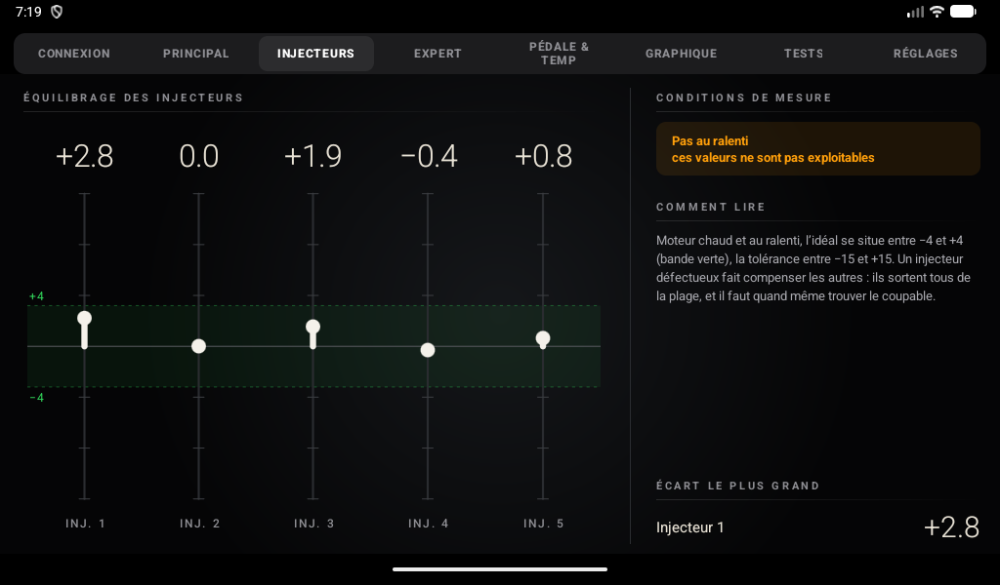
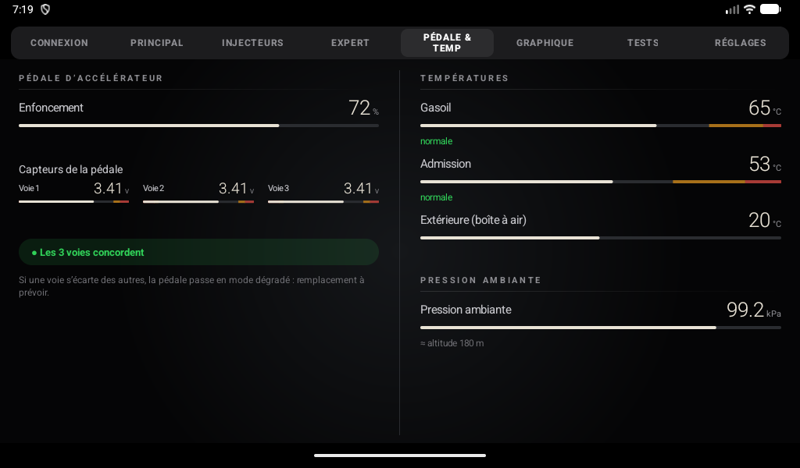
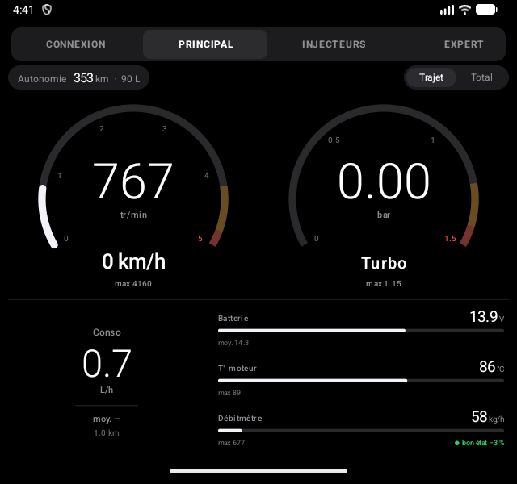

# TD5 Dash

Tableau de bord et outil de diagnostic pour moteur **Land Rover TD5**, pensé pour un
autoradio Android de 1024 × 600, lisible d'un coup d'œil en conduisant.


L'application se connecte toute seule au calculateur dès que le câble est détecté, et
s'ouvre directement sur les jauges.

---

## Le principe : le silence veut dire que tout va bien

Les jauges restent **blanches** tant qu'une valeur est dans sa plage normale. La couleur
n'apparaît **que** lorsqu'une valeur en sort. Un écran blanc veut dire que tout est
correct ; s'il y a une seule tuile colorée, c'est là qu'il faut regarder.

| État | Couleur | Exemple |
|---|---|---|
| Normal | blanc | liquide à 86 °C |
| Encore froid | bleu | liquide sous 70 °C |
| Attention | orange | liquide au-dessus de 96 °C |
| Alerte | rouge, **carte teintée** | liquide au-dessus de 105 °C |


La carte entière se teinte en alerte, pour qu'un défaut se voie du coin de l'œil. C'est
indispensable pour les valeurs basses, comme une batterie à 10,9 V, dont l'arc est trop
court pour attirer le regard à lui seul.

---

## Les écrans

### Principal

Un combiné d'instruments : deux grands cadrans, **régime** (avec la vitesse dessous) et
**turbo**, les zones orange et rouge tracées en sombre sur le cadran. Au centre, la
**consommation instantanée** (L/100 km en roulant, L/h à l'arrêt) avec la moyenne et les
kilomètres. En bas, **batterie**, **T° moteur** et **débitmètre** en barres. Un bandeau
apparaît tant que le moteur n'est pas chaud.

- **Trajet / Total** : les petites lignes sous chaque valeur (max, moyennes, kilomètres)
  montrent le trajet en cours ou, en violet, le total conservé jusqu'à sa remise à zéro
  (appui long sur « Total »).
- **Autonomie** : en haut à gauche, les kilomètres et litres restants. On déclare chaque
  plein, complet ou partiel ; les litres affichés par la pompe servent à **caler
  automatiquement la consommation** d'un plein complet à l'autre, et à signaler les
  trajets faits sans la tablette.
- **État du débitmètre** : sous sa barre, l'écart entre le débitmètre et l'estimation du
  calculateur par le capteur de collecteur, mesuré moteur chaud, en charge et en régime
  stable (EGR fermée). Vert, orange ou rouge, avec l'historique des 10 derniers trajets.

### Injecteurs



Balance des cinq injecteurs en colonnes autour de zéro, sur une bande verte de −4 à +4 :
l'injecteur qui s'écarte saute aux yeux. L'application connaît le
régime et la température : elle annonce **MOTEUR FROID** ou **PAS AU RALENTI** quand les
conditions de mesure ne sont pas réunies, plutôt que de laisser lire des valeurs qui ne
veulent rien dire.

### Expert


Les huit valeurs de cartographie, en tuiles : le gasoil (demande, limiteurs de couple et
de fumée, quantité injectée) sur la même échelle, l'air et le ralenti à côté. Aucune n'a
de seuil d'alerte : la documentation d'origine est explicite, il n'y a pas de bonne ou de
mauvaise valeur.

### Pédale et températures



Les trois voies de pédale, l'enfoncement en pourcentage, la pression ambiante et les
températures gasoil, admission et extérieure.

### Tests d'actionneurs


Quatorze commandes envoyées au calculateur : pompe à gasoil, préchauffage, voyant moteur,
jauge de température, impulsion de régime, embrayage et ventilateur de clim, modulateurs
EGR et turbo, et chaque injecteur isolément.

Les boutons sont **désactivés tant que le calculateur n'est pas connecté**, et chaque test
demande une confirmation avec un avertissement adapté.

### Connexion


Identité du véhicule lue au calculateur — VIN, type d'ECU, variante de cartographie —,
codes défaut décodés en clair, et le journal brut. L'effacement des défauts demande
confirmation et prévient que c'est irréversible.

### Réglages


Le **modèle** (Discovery 2, Defender 90, 110 ou 130), qui fixe la capacité utile du
réservoir, puis les seuils et corrections : couleurs des jauges, **correction de vitesse**
pour des pneus non d'origine (vitesse compteur et vitesse GPS au même moment, par exemple
120 et 130), correction de consommation. Les valeurs d'usine des seuils viennent des
notes publiées par l'auteur de l'application d'origine. Un bouton remet tout en place.

---

## Aide à la lecture


Chaque jauge porte un **ⓘ**. Un appui ouvre sa fiche : ce que la valeur signifie, les
plages attendues, et le pic de la session avec un bouton de remise à zéro.

---

## Écran partagé



L'application accepte le mode fenêtré et bascule sur une mise en page compacte sous 700
points de large, pour tenir à côté d'un GPS.

---

## Matériel

Un câble **KKL VAG-COM à puce FTDI FT232R** (`0403:6001`), branché sur le port USB de
l'autoradio et sur la prise diagnostic du véhicule.

Au premier branchement, Android propose **« Toujours ouvrir pour cet appareil »**. Cocher
la case accorde l'autorisation une fois pour toutes et lance l'application dès que le
câble est détecté.

---

## Installation

Télécharger [l'APK](apk/td5-dash-v1.6.apk) et l'ouvrir sur l'autoradio. Les versions suivantes s'installent par-dessus, sans désinstaller.
Il faut autoriser l'installation depuis des sources inconnues.

L'application s'installe **à côté** de TD5 InfoDash, avec son propre identifiant
`com.mooo.hairyone.td5dash` : les deux peuvent cohabiter.

### Mode démo

Un **appui long sur le bouton de connexion** simule les 26 valeurs à partir d'un cycle
moteur cohérent : quand le régime monte, le turbo, le débit et les températures suivent.
Utile pour montrer l'application ou travailler l'interface sans véhicule. Le mode est un
drapeau d'exécution, désactivé par défaut, jamais compilé dans l'application.

---

## Corrections de données

Le code d'origine comportait plusieurs erreurs d'affichage, corrigées ici :

| Problème | Ce qui se passait | Maintenant |
|---|---|---|
| Valeurs négatives | la jauge écrêtait à zéro, donc toute la moitié négative de la balance injecteur était invisible | jauge bipolaire, le négatif s'affiche |
| Turbo faux en altitude | une atmosphère fixe de 1 bar était soustraite ; à 1500 m la jauge annonçait 0,15 bar au ralenti | la pression ambiante **mesurée** est utilisée |
| Enfoncement de pédale | affiché « 5 VOLT » alors que c'est 50 % de pédale | converti et affiché en pourcentage |
| Sonde de boîte à air | absente sur les 10P, elle affichait 197 °C comme une vraie mesure | un tiret |
| Débitmètre mort | 0 ou 4,4 kg/h s'affichaient comme des mesures | un tiret |
| Données figées | une lecture ratée laissait la dernière valeur à l'écran, indiscernable d'une valeur vivante | **SIGNAL PERDU** après 2,5 s |
| Couple et fumée | les deux octets étaient lus dans l'ordre inverse | ordre corrigé, voir ci-dessous |

Sur le dernier point, les sources sont contradictoires. L'ordre retenu est celui de la
version 3 de l'application d'origine, appuyé sur les libellés du projet
[Ekaitza_Itzali](https://github.com/EA2EGA/Ekaitza_Itzali) et sur un relevé réel où la
limite de fumée est bien la plus basse des deux au ralenti chaud. **Confiance estimée à
80 %**, faute de documentation constructeur.

Toutes les conversions sont isolées dans une classe pure et couvertes par **41 tests
unitaires**.

---

## Compiler depuis les sources

```bash
./gradlew assembleDebug
./gradlew testDebugUnitTest
```

JDK 17, AGP 8.7, `minSdk` 21, `targetSdk` 34.

---

## Origine et licence

Ce projet dérive de [hairyone/TD5Tester](https://github.com/hairyone/TD5Tester), sous
licence Apache 2.0, et du code source « TDB TD5 V2 » publié par l'auteur de TD5 InfoDash.

Le protocole de dialogue avec le calculateur, les requêtes ECU et la table des codes
défaut viennent de ces deux projets. Ce dépôt y ajoute la migration vers un socle Android
moderne, la refonte de l'interface, les corrections de données listées ci-dessus, les
tests unitaires et les réglages.

Licence Apache 2.0, voir [LICENSE](LICENSE) et [NOTICE](NOTICE).

---

## Ce qui n'est pas éprouvé

- Les **tests d'actionneurs** n'ont jamais été envoyés à un vrai calculateur. Les trames
  viennent du projet d'origine et sont justes sur le papier, mais à prendre comme non
  vérifiées. Commencer par une commande inoffensive avant de toucher aux injecteurs.
- Le **lancement au démarrage** dépend de la ROM : depuis Android 10, démarrer une
  activité depuis l'arrière-plan est bridé. Beaucoup d'autoradios ont leur propre réglage
  « Boot app », plus fiable.
- L'**écran partagé** est débloqué côté application, mais certaines ROM d'autoradio
  désactivent le mode fenêtré au niveau du système.
- Le **calage automatique de la consommation** au plein et le **verdict du débitmètre**
  (seuils ±8 % et ±15 %) sont vérifiés par des tests et dans l'émulateur, pas encore
  sur plusieurs pleins réels. Les seuils du débitmètre sont réglables.
